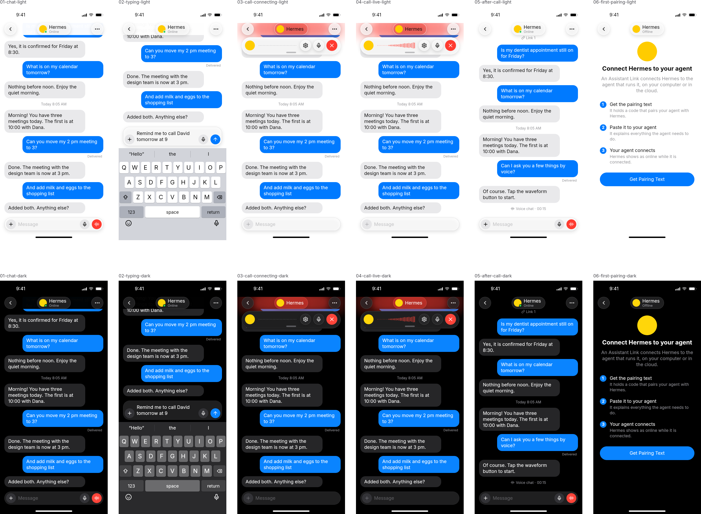
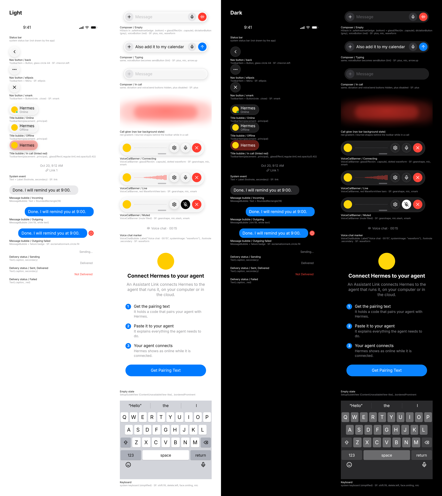

# Assistant Link iOS: native app design (issue #9)

These mocks show the layout and states of the conversation screen and the first-pairing screen, inspired by Grok Bot, in light and dark. Every screen is built from the components below. Inter and Lucide icons stand in for SF Pro and SF Symbols, and glass is approximated (no blur), so the SwiftUI snapshot is what gets approved. Frames are iPhone 393 x 852 pt. Screens: `01-chat`, `02-typing`, `03-call-connecting`, `04-call-live`, `05-after-call`, `06-first-pairing`, each in `-light` and `-dark`, plus a component sheet.

Sample assistant: "Hermes" (yellow avatar). Chat blue is the system tint; the call is red (iOS call convention).

## Conversation layout (all chat screens)

`ScrollView` (bottom-anchored with `.defaultScrollAnchor(.bottom)`) under a glass navigation bar; `ComposerView` in `.safeAreaInset(edge: .bottom)` floating over the content; system status bar and home indicator. Messages scroll under the nav buttons and the title bubble (scroll-edge effect). Screen margins 16, gap between bubbles 12 (4 above a delivery caption).

## Components

### Navigation bar

| Part | SwiftUI | SF Symbol | Colors | Notes |
|---|---|---|---|---|
| Back button | `ToolbarItem(placement: .topBarLeading)` + `Button`, glass circle 44 | `chevron.left` | `.primary` on `.glassEffect(in: .circle)` | system back |
| Title bubble | `ToolbarItem(placement: .principal)`, `.glassEffect(in: .capsule)`, avatar 28 | none | name `.headline`, status `.caption` `.secondary`; online dot `.green`, idle dot `.yellow` | States: Online, Idle, Offline, In call (name only, glass tinted light red, `.glassEffect(.regular.tint(.red.opacity(0.4)))`) |
| Call glow | background view behind the toolbar, only while in a call | none | translucent `.red` | see below |

### Call glow (nav bar background state)

While a call is active the nav bar gets a soft red glow behind the status bar, the nav buttons and the title bubble; there is no separate call pill. Plain SwiftUI, no CallKit: a view behind the toolbar, for example `.toolbarBackground` with a red gradient, or a `ZStack` background of a `RadialGradient` (`.red` at about 35% to clear) plus a blurred red `Capsule` (opacity about 0.3, `.blur(radius: 24)`), about 150 pt tall from the top of the screen, fading in and out with the call (`.animation`). Content under the nav bar picks up a red cast, as in the reference video.

### Message bubble, system event, delivery status

| Part | SwiftUI | Colors | Font | States |
|---|---|---|---|---|
| Incoming bubble | `Text` + `.padding(.horizontal, 14).padding(.vertical, 9)` + `RoundedRectangle(cornerRadius: 18)` | fill `Color(.secondarySystemBackground)`, text `.primary` | `.body` | max width about 295 |
| Outgoing bubble | same | fill `.tint`, text `.white` | `.body` | Outgoing failed adds a red badge (`exclamationmark.circle.fill`, `.red`), label "Not Delivered" |
| System event | `Text` + `Label` | `.secondary` | `.footnote` | date line plus link name (`link`) |
| Time caption | `Text` | `.secondary` | `.footnote` | "Today 8:05 AM" |
| Delivery status | `Text`, trailing, 4 pt inset | `.secondary`; failed `.red` | `.caption` | Sending…, Sent, Delivered, Not Delivered |

### Composer (`messageComposer`, `messageField`, `dictationButton`, `sendButton`)

| Part | SwiftUI | SF Symbol | Colors | Font / copy |
|---|---|---|---|---|
| Container (`messageComposer`) | `HStack(alignment: .bottom)` in `.safeAreaInset(edge: .bottom)`, margins 16, padding 6; the buttons sit inside the box on its bottom row | none | glass `RoundedRectangle(cornerRadius: 24)`, the same radius at every height (not a capsule), separator stroke | grows to 6 lines (`lineLimit(1...6)`), then scrolls |
| Plus button (`attachButton`) | `Button`, circle 36 | `plus` | `.primary` on `Color(.tertiarySystemFill)` | shown disabled for now; see open questions |
| Field (`messageField`) | `TextField("Message", text:, axis: .vertical)` | none | text `.primary`, placeholder `.tertiary` | `.body` |
| Dictation (`dictationButton`) | `Button("Dictate")`, plain grey circle 36, trailing, only while the draft is empty | `mic` | `.primary` on `Color(.tertiarySystemFill)` | label "Dictate" |
| Send button (`sendButton`) | `Button("Send")`, circle 36, in the spot of the dictation button once there is text or while dictating | `arrow.up` | `.white` on `.tint` | label "Send" |

States: Empty (plus, field, dictation), Typing (plus, field, send; the box grows with the draft), Dictating (the words across the full width, then a row of stop `stopDictationButton` in place of plus, elapsed time, waveform, and send), In call (plus disabled; no trailing button, as in the video; the field stays visible).

### Start-call control (`voiceButton`)

A `Button("Call")` with the `phone` symbol in the navigation bar, trailing. Tapping the title bubble opens Details, so there is no More menu. It starts the voice chat and is hidden while a call with this Assistant is on, because the banner has End and Mute. Dictation stays in the composer and only focuses the field.

### Voice call banner (`voiceMute`, `voiceEnd`)

A glass capsule below the nav bar (x 16, 361 x 64, `.glassEffect(in: .capsule)`). No name and no status text: the name is in the nav title.

| Part | SwiftUI | SF Symbol | Colors | Copy |
|---|---|---|---|---|
| Avatar | `Circle`, 36, left | none | avatar yellow | none |
| Waveform | `WaveformView`, thin bars growing toward the right, `.red`; Connecting and Live show the bars, Muted a flat dotted line (`.tertiary`) | none | `.red` | none |
| Mute (`voiceMute`) | `Button`, glass circle 40; muted = filled `.primary` circle | `mic` / `mic.slash` | `.primary` | "Mute" / "Unmute" |
| End (`voiceEnd`) | `Button`, filled `.red` circle 40, `.white` glyph | `xmark` | `.red` | "End voice chat" |

Variants: Connecting (bars, the mic is already live), Live (bars), Muted (dotted waveform, filled mute button).

Swiping the banner up hides it and leaves a small chevron button that brings it back; VoiceOver gets a "Hide" action. VoiceOver reads the banner as "Voice chat" with the value Connecting, Live, Muted or Not listening.

### Voice chat marker (`VoiceChatBubble`)

Not a bubble: a small centered caption under the last assistant message, `Label("Voice chat · 00:15", systemImage: "waveform")` in `.footnote`, `.secondary`. No summary line, no other voice turns in the timeline.

### Empty state (`createLink`)

| Part | SwiftUI | Colors | Font / copy |
|---|---|---|---|
| Avatar | `Circle`, 72 | avatar yellow | none |
| Title | `Text` | `.primary` | `.title2.bold()`, "Connect Hermes to your agent" |
| Body | `Text`, centered | `.secondary` | `.body`, "An Assistant Link connects Hermes to the agent that runs it, on your computer or in the cloud." |
| Steps | three `HStack`: number badge 24 (`.tint`, white `.subheadline.bold()`), title `.headline`, detail `.subheadline` `.secondary` | | 1 Get the pairing text / It holds a code that pairs your agent with Hermes. 2 Paste it to your agent / It explains everything the agent needs to do. 3 Your agent connects / Hermes shows as online while it is connected. |
| Button (`createLink`) | `Button("Get Pairing Text")`, `.buttonStyle(.borderedProminent)`, `.buttonBorderShape(.capsule)`, `.controlSize(.large)` | `.tint` | `.headline` |

### Keyboard

System keyboard (simplified in the mock); the composer sits directly on top of it and the home indicator is hidden.

## Screens

- **01-chat.** Timeline ending with "Added both. Anything else?", Composer Empty. The red waveform button starts a voice chat; typing turns it into Send. Only the 2 pm request shows "Delivered".
- **02-typing.** Newest message visible, draft "Remind me to call David tomorrow at 9" wraps to two lines and grows the capsule; keyboard below, home indicator hidden. Send takes the spot of the dictation mic, posts the message and clears the draft.
- **03-call-connecting.** Call glow behind the nav bar, title bubble tinted red, banner Connecting (live waveform) under the nav bar, Composer In call. The video shows no collapsed state, so the banner is always visible during a call.
- **04-call-live.** Same, banner Live (red bars). Mute toggles (Muted variant), End ends the call. v1 has no settings button and no grabber: the banner stays while the call lasts.
- **05-after-call.** End removes the glow and the banner and posts the "Voice chat · 00:15" caption under the last assistant message. Composer Empty again.
- **06-first-pairing.** Hermes before any Link is paired: back button, title bubble Offline, empty state with the three steps and "Get Pairing Text". No composer.

## Dark mode

Colors are semantic, so dark follows the system: bubbles use `secondarySystemBackground` (dark grey), the tint becomes the dark-mode blue, glass turns dark grey, symbols use `.primary` (white). The red of the call glow, voice and End buttons and waveform stays `.red`.

## Open questions

1. The plus button is reserved for attachments and shown disabled; keep it visible now, or hide it until attachments exist?
2. Should "Delivered" show only on the latest outgoing message (as iOS Messages does) or stay on older ones, as in the 2 pm request here?
3. Settings in the banner: what does it open (voice, speed, input device)? The mock only draws the button.
4. Is the dictation mic needed in v1, or should the composer start with plus, field and the voice button only?

## Images

